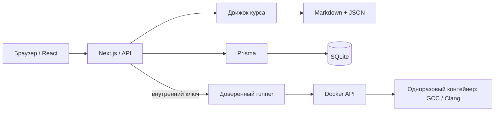

# Архитектура

Приложение использует npm workspaces. Next.js обслуживает страницы и HTTP API; React получает только публичное представление урока. Файловый движок курса читает Markdown и JSON на сервере и проверяет их Zod. Prisma работает с локальной SQLite.

## Ответственность пакетов

- `packages/shared`: общие схемы Zod, типы запросов и ответов, сравнение результата, расчёт прогресса.
- `packages/course-engine`: определение каталога контента, чтение файлов, проверка ссылок и prerequisites, поиск, удаление секретной части данных перед отправкой клиенту.
- `packages/ui`: небольшие общие примитивы — индикатор прогресса, метки и пустые состояния.
- `apps/web/lib`: пользователь, БД, HTTP-границы, агрегирование прогресса и клиент runner.
- `apps/runner`: лимитированная очередь и управление строго фиксированным образом Docker.

## Модель данных

| Модель            | Что хранит                                                              |
| ----------------- | ----------------------------------------------------------------------- |
| `User`            | Локальный пользователь; уникальный `localKey = local`                   |
| `Settings`        | Ритм обучения, компилятор и размер шрифта; отношение 1:1                |
| `CourseProgress`  | Агрегат курса: число уроков, завершённые уроки, процент, последний урок |
| `LessonProgress`  | Чтение, quiz, практика, время завершения                                |
| `ExerciseAttempt` | Код, ввод, режим, компилятор, стандарт, результат и время попытки       |
| `QuizAttempt`     | Выбранные ответы, результат, число вопросов, успешность и время         |
| `Bookmark`        | Уникальная закладка пользователя на урок                                |
| `Draft`           | Последний код и stdin; песочница использует отдельный ключ              |
| `StudyDay`        | День реального учебного действия, один раз на пользователя/день (UTC)   |

Миграции сохраняют данные прежней реализации: `User` отображается на таблицу `Profile`, `LessonProgress` — на `Progress`, `ExerciseAttempt` — на `Attempt`. Имена таблиц — деталь совместимости. Настройки вынесены в самостоятельную таблицу; ранний профиль при обновлении принимается за локального пользователя. Остальные прежние записи сохраняются, но не образуют доступные через интерфейс учётные записи.

Локальный пользователь создаётся через `upsert`. Изменение результата урока и агрегата курса выполняется в одной транзакции. `completedAt` не перезаписывается при повторном завершении. Файлы курса остаются источником истины для состава программы: неопубликованные материалы не увеличивают число уроков и не появляются в поиске.

## Выполнение

Web проверяет исходник и параметры, передаёт runner только разрешённую конфигурацию и набор stdin. **Ожидаемые ответы остаются в web**. Playground использует строгий `/execute`, проверки заданий — внутренний `/check`. Runner управляет Docker CLI, измеряет время и ограничивает потоки вне sandbox; компилятор и программы работают только внутри контейнера. Для каждого теста создаётся новый контейнер без переноса бинарных файлов на хост или состояния между тестами. После подтверждённого удаления контейнера web сохраняет попытку; для заданий сравнивает stdout и обновляет прогресс при успешной проверке.

В браузер не попадают исходные данные или фактический вывод скрытых проверок. В истории сохраняется уже отфильтрованный результат. Разбор открывается отдельным запросом после первой проверки собственного решения.

## Конфигурация

Переменные описаны в `.env.example`; локальный `setup` генерирует ключ. В Docker секрет находится в отдельном томе и монтируется в web/runner только для чтения. База имеет отдельный именованный том. Сервисы runner и web соединены внутренней сетью; только web публикует порт на loopback хоста.

Выбор SQLite/Prisma соответствует [официальному SQLite connector](https://www.prisma.io/docs/orm/overview/databases/sqlite); маршруты реализованы через [Next.js Route Handlers](https://nextjs.org/docs/app/getting-started/route-handlers). Материалы курса и интерфейс написаны для этого проекта.
